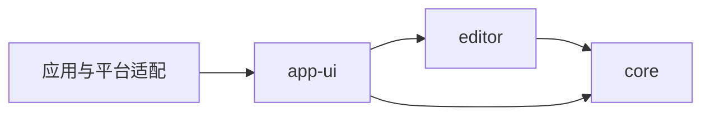

# 编辑器包边界与分发约定

用途：说明编辑器三个包及 React 子入口的职责、调用入口和依赖方向，供嵌入、重构与后续 npm 发布参考。

| 包 | 职责 | 主要入口 |
| --- | --- | --- |
| `@md-editor/core` | 无 DOM、无 React、无 CodeMirror 的文档状态、保存和外部编辑协议、命令/快捷键、无头运行时 | `createDocumentState`、命令与运行时 API |
| `@md-editor/editor` | 基于 CodeMirror 6 的浏览器编辑器，拥有 transaction、selection、history、IME、投影、lint 与 suggestion 交互；主入口无 React 运行时或类型依赖 | `createCodeMirrorEditorBridge`、editor ports、suggestion 类型；可选 React 子入口见下文 |
| `@md-editor/app-ui` | 应用接线、大纲、菜单、设置、主题、controller；`AppEditor` 接回大纲、端口注册和应用语言传递 | `AppEditor`、`EditorUiProvider`、面板和 hooks |

图中展示三个包之间的主链与直接契约依赖，各包还声明实际使用的 SDK、解析、保真及工具包依赖。`core` 不依赖浏览器引擎；`editor` 不依赖 `app-ui`、应用 i18n、Tauri 或应用 store。

`@md-editor/editor/react` 是 `editor` 包的可选子入口，源码位于 `packages/editor/src/react/`。它导出 `CodeMirrorEditor` 和 `CodeMirrorEditorProps`，只负责 React 挂载、bridge 生命周期、snapshot 订阅及 props/callback 转发。它与主入口共享包版本，不是独立 workspace 或 npm 包。主入口不能反向导出 React 组件或类型；React 测试辅助 API 位于 `@md-editor/editor/react/testing`。

非 React 宿主从 `core` 创建文档，通过 `editor` 的 bridge 挂载。React 社区使用者从 `editor/react` 挂载组件；无需引入应用 Provider、主题编译器或设置页面。仓库内应用使用 `app-ui` 的 `AppEditor`，延续应用大纲和命令接线。应用通过 `useTranslation` 将当前语言传给 React 子入口，由组件单次刷新 lint，不再额外监听全局语言事件。

每个调用方直接从契约归属包导入。迁移后不保留旧包、旧子路径和无意义的兼容 re-export。`CodeMirrorEditor` 保留组件名称，因为它明确表示当前具体编辑器实现；包名 `editor` 表示其职责覆盖编辑交互，而不限于视觉渲染。

## npm 分发

当前这三个包仍为 `private` workspace 包，本次只完成职责拆分、命名迁移和子入口整理，不代表已经发布。

后续构建并发布 npm 包时，保留包依赖：`editor` 通过正常 dependencies 依赖 `core` 等实际使用的包，不把内部包打入同一产物。每个包都发布可解析的 JavaScript、类型声明和必要样式/资源，并为实际使用的子路径配置 `exports`。发布顺序和版本范围应覆盖所有尚未发布的传递 workspace 依赖。

React 声明为 `editor` 的 optional peer（`>=18.3.0 <20`，`peerDependenciesMeta.react.optional = true`），并作为开发依赖支持本仓库测试。只使用主入口的消费者无需安装 React；导入 `/react` 的消费者自行安装符合范围的 React。组件不直接使用 React DOM，所以 React DOM 仅作为开发依赖，由 React 宿主自行选择和安装。

npm 的 peer 元数据属于整个包，无法按子入口声明。宿主已安装 React 时仍可能受到 peer 版本检查；缺少 React 而使用 `/react` 时，错误会在模块解析或构建阶段出现。后续发布构建必须分别输出主入口与 React 子入口的 JS / 类型声明，并将 React 和 JSX runtime 保持为外部依赖，避免主入口产物引入 React。

## 验证

移动已有 core、editor 与 React 回归测试，并更新各端调用方、工作区依赖、结构约束、CI 路径、注释和中英文 README。主入口边界测试拒绝 React 模块解析，分别验证真实运行时导入和非 React 消费者的类型检查。React bridge 浏览器用例继续验证 StrictMode、外部编辑、history、selection 与 IME；应用接线单测验证大纲、端口注册，以及语言切换只触发一次 lint 刷新。
