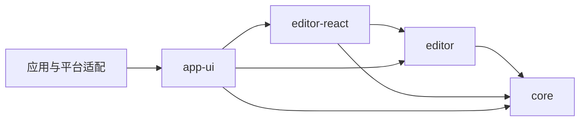

# 编辑器包边界与分发约定

用途：说明编辑器四个包的当前职责、调用入口和依赖方向，供嵌入、重构与后续 npm 发布参考。

| 包 | 职责 | 主要入口 |
| --- | --- | --- |
| `@md-editor/core` | 无 DOM、无 React、无 CodeMirror 的文档状态、保存和外部编辑协议、命令/快捷键、无头运行时 | `createDocumentState`、命令与运行时 API |
| `@md-editor/editor` | 基于 CodeMirror 6 的浏览器编辑器，拥有 transaction、selection、history、IME、投影、lint 与 suggestion 交互；不依赖 React 或平台 runtime | `createCodeMirrorEditorBridge`、editor ports、suggestion 类型 |
| `@md-editor/editor-react` | 独立 React 挂载组件、bridge 生命周期、snapshot 订阅与 props/callback 转发 | `CodeMirrorEditor`、`CodeMirrorEditorProps` |
| `@md-editor/app-ui` | 应用接线、大纲、菜单、设置、主题、controller；`AppEditor` 接回大纲、端口注册和应用语言事件 | `AppEditor`、`EditorUiProvider`、面板和 hooks |

图中展示四包之间的主链与直接契约依赖，各包还声明实际使用的 SDK、解析、保真及工具包依赖。`editor-react` 不依赖 `app-ui`、应用 i18n、Tauri 或应用 store；`editor` 不反向依赖 React；`core` 不依赖浏览器引擎。

非 React 宿主从 `core` 创建文档，通过 `editor` 的 bridge 挂载。React 社区使用者从 `editor-react` 挂载组件；无需引入应用 Provider、主题编译器或设置页面。仓库内应用使用 `app-ui` 的 `AppEditor`，延续应用大纲和命令接线。

每个调用方直接从契约归属包导入。迁移后不保留旧包、旧子路径和无意义的兼容 re-export。`CodeMirrorEditor` 保留组件名称，因为它明确表示当前具体编辑器实现；包名 `editor` 表示其职责覆盖编辑交互，而不限于视觉渲染。

## npm 分发

当前这四个包仍为 `private` workspace 包，本次只完成职责拆分和命名迁移，不代表已经发布。

后续构建并发布 npm 包时，保留包依赖：`editor` 依赖 `core`，`editor-react` 依赖 `editor` 和 `core`；不把内部包打入同一产物。每个包都发布可解析的 JavaScript、类型声明和必要样式/资源，并为实际使用的子路径配置 `exports`。React 和 React DOM 保持 peer dependencies。发布顺序和版本范围应覆盖所有尚未发布的传递 workspace 依赖，而不是只发布顶层 React 包。

## 验证

移动已有 core、editor 与 React 回归测试，并更新各端调用方、工作区别名、结构约束、CI 路径、注释和中英文 README。React bridge 浏览器用例继续验证 StrictMode、外部编辑、history、selection 与 IME；应用接线单测验证大纲、端口注册和语言事件清理。
