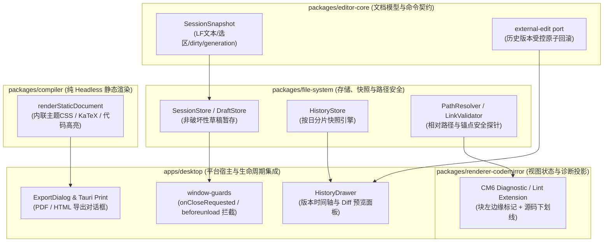
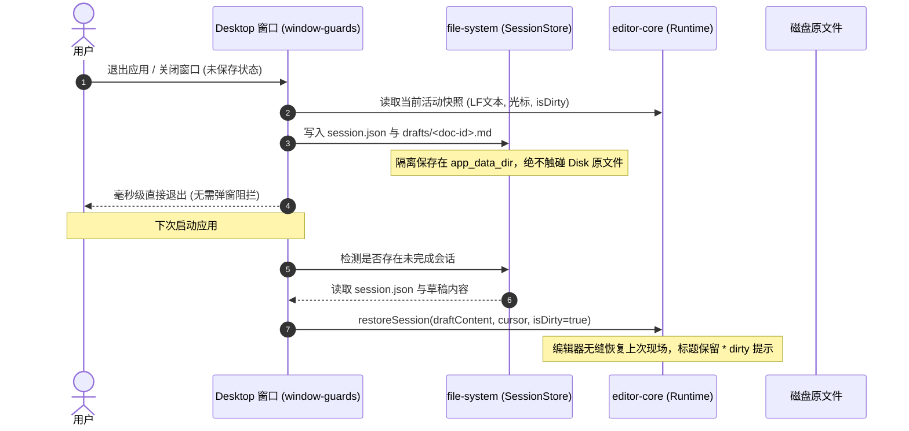
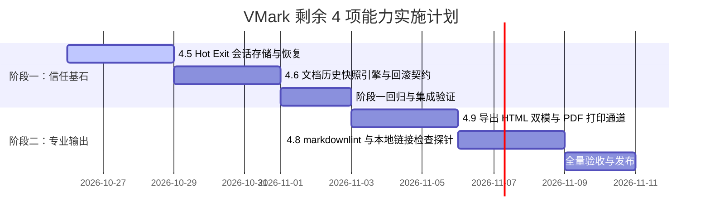

# VMark 剩余核心能力落地技术方案（Hot Exit、文档历史、Lint/链接检查与导出）

> 用途：针对竞品分析 [`vmark_competitive_analysis.md`](../product/vmark_competitive_analysis.md) 中规划的剩余 4 项核心能力（第 3 批「信任基石」：4.5 Hot Exit + 4.6 文档历史；第 5 批「专业输出」：4.8 Markdown Lint/链接检查 + 4.9 导出 HTML/PDF），依据 [架构能力边界设计原则](./capability_boundary_design_principles.md) 与 AGENTS.md 规范，确立领域归属、开源复用选型、状态契约与分步实施路线。

---

## 一、 方案背景与目标

在前期迭代中，手感增强（自动配对与 Tab 跳出、块级操作、专注/打字机模式）、差异化（CJK 友好定界符与本地 SLM 标点排版）以及 AI 智能赋能（多协议 AI Harness 与审批式流式建议）均已完成并交付。

当前项目距离“日常主力技术写作工具”与“完整技术文档闭环”尚存两组最关键的缺口：
1. **信任基石（数据安全与防丢）**：日常写作无需每次关闭前弹窗确认，意外关闭或崩溃能无损还原（Hot Exit）；误删或改乱内容可追溯时间轴并随时原子回滚（文档历史快照）。
2. **专业输出（交付与质量保障）**：技术文章一键导出开箱即用的优美独立 HTML 或 PDF（导出）；开源文档与博客链接不错链、Markdown 语法规范自检（Lint 与链接检查）。

---

## 二、 架构能力边界与领域职责矩阵

严格遵守核心能力收敛到所属领域、接入层只做协议转换与注入的原则：



### 职责边界映射表

| 能力模块 | 领域本体 | 核心承载包 | 接入与 UI 容器 | 严格禁止事项（反模式） |
|---|---|---|---|---|
| **4.5 Hot Exit** | 会话持久化与生命周期 | `packages/file-system`<br/>`packages/editor-core` | `apps/desktop` (`window-guards.ts`) | 严禁把未保存草稿直接覆盖用户磁盘原文件；严禁把会话状态保存在 React 组件 state 中。 |
| **4.6 文档历史** | 版本存储与原子回滚 | `packages/file-system` (版本存取)<br/>`packages/editor-core` (受控事务) | `apps/desktop`<br/>`packages/editor-ui` | 严禁历史恢复绕过 CM6 transaction（必须天然支持 `Cmd+Z` 撤销反悔）；严禁在用户工作区随意散落隐藏文件夹。 |
| **4.8 Lint / 链接检查** | 语法自检与文件可达性 | 外部复用 `markdownlint`<br/>`packages/file-system` (路径探测) | `packages/renderer-codemirror` (诊断投影) | 严禁自研 50+ 条脆弱正则规则（必须复用成熟开源）；严禁 Lint 模块直接调用 Node fs 穿透检查；严禁按键实时查磁盘。 |
| **4.9 导出 HTML / PDF** | 静态排版与文档分发 | `packages/compiler` (静态文档)<br/>Tauri 2 原生 Webview Print | `apps/desktop` (导出面板) | 严禁自研 PDF 复杂排版引擎；严禁让用户纠结“单文件还是外链”设置（直接同时产出两份）。 |

---

## 三、 四大核心模块技术方案详解

### 3.1 模块一：4.5 Hot Exit + 会话恢复

#### 1. 核心流程与非破坏性草稿暂存


#### 2. 关键设计契约
1. **草稿隔离存储**：
   - 会话元数据存储在系统应用数据目录：`app_data_dir/sessions/session.json`。
   - 存在未保存修改的文件存入：`app_data_dir/sessions/drafts/<filePathHash>.draft.md`。
   - **安全不变量**：只要用户未显式按 `Cmd+S`，源文件在磁盘上保持原汁原味，不发生任何写入。
2. **状态与 Dirty 标记还原**：
   - 恢复后的文档模型必须严格保持 `isDirty === true`，窗口标题显示修改星号 `*`。
   - 用户显式执行“保存”时，才将草稿内容通过 `SaveCommitGate` 原子写入源文件并清空草稿；用户若执行“放弃未保存变更”，则重载源文件并删除暂存草稿。
3. **快照 TTL 清理策略**：
   - 每次保存成功自动删除对应 draft。
   - 启动时自动清理超过 7 天且源文件已被移动/删除的孤立草稿文件。

---

### 3.2 模块二：4.6 文档历史快照

#### 1. 存储结构设计
统一收敛于应用数据目录，杜绝在用户工作区产生垃圾文件：
```text
app_data_dir/
└── history/
    └── <encoded-absolute-path-or-hash>/
        ├── index.jsonl           # 历史快照元数据索引 (时间戳、commit 类型、字符数、diff 摘要)
        └── snapshots/
            ├── 1729900000.snap   # 对应时刻的不可变 LF 纯文本全量快照
            └── 1729986400.snap
```

#### 2. 触发时机与存储限额
- **触发点**：
  1. 用户显式按 `Cmd+S` 保存成功后自动记录；
  2. 连续编辑中，空闲防抖满 5 分钟且内容哈希变化时自动保存静默快照；
  3. 执行“恢复历史版本”前，强制先给当前内容留存一份瞬时快照。
- **容量上限与滑动窗口**：
  - 单个文档最多保留 100 个快照，超过上限时自动按 FIFO 淘汰最老快照（保留每天的第一个快照）。

#### 3. 原子受控回滚（Zero-Risk Revert）
- 恢复历史版本**严禁绕过编辑器事务**。必须通过 `editor-core` 的受控外部编辑通道（`applyExternalEdit`）执行整篇替换。
- **收益**：恢复历史版本在 CM6 中被视为一次普通编辑，用户立即按 `Cmd+Z` 即可反悔撤销恢复，彻底消除误操作风险。

---

### 3.3 模块三：4.8 Markdown Lint + 本地链接检查

#### 1. 规则引擎选型与开源复用（AGENTS.md 第 2 条）
- **复用方案**：选用成熟且测试完备的 [`markdownlint`](https://github.com/DavidAnson/markdownlint) / `markdownlint-rule-helpers`（几百个测试用例，覆盖 MD001-MD050 常见规范）。
- **配置策略**：默认启用常见核心子集（标题层级递增、列表前空行、代码块围栏闭合等），支持配置关闭或调整级别（warning/error）。

#### 2. 本地链接检查设计契约（吸收 VMark 最佳实践）
1. **范围收敛**：
   - 严格只查**本地相对路径**（`./images/demo.png`、`../docs/api.md`）。
   - 外部网络 URL（`http://`、`https://`）与同文件纯锚点（`#section-heading`）直接跳过（网络状态与锚点在其他通道处理，避免产生网络抖动与误报）。
2. **安全边界**：
   - 链接检查引擎严禁自行接触文件系统，必须调用 `packages/file-system` 提供的异步 `verifyRelativeFileExists(basePath, relativeTarget)` 契约。
   - 解析时必须经标准 URL 解码（处理中文路径与空格 `%20`）。
3. **时机与性能防护**：
   - **绝不在每次打字按键触发**；只在文档保存后静默异步并发执行，或通过命令面板“检查文档链接与格式”显式触发。
   - 检查任务按解析后的目标绝对路径进行去重，避免对同张重复图片发起多次 I/O。
4. **容错降级（Fail-open）**：
   - 遇到系统无权限、路径受限或沙箱隔离错误时，标记为 `error`（跳过）而非 `missing`（未找到），遵循“宁可漏报，不可误报”的保信原则。

#### 3. 视图层投影
- 在 `packages/renderer-codemirror` 中接入 CodeMirror 6 原生 `@codemirror/lint`：
  - **WYSIWYG 模式**：不在正文文字下方加杂乱波浪线（破坏沉浸感），统一在块左侧边缘或 Gutter 显示轻量提示点，鼠标悬停展开 Hover Tooltip；
  - **Source 模式**：CM6 标准波浪线下划线 + 行号槽诊断图标；
  - **快捷跳转**：注册 `F2`（下一处问题）与 `Shift+F2`（上一处问题）命令。

---

### 3.4 模块四：4.9 导出 HTML / PDF

#### 1. HTML 导出架构（复用 `@md-editor/compiler`）
- 本仓库 [`packages/compiler`](file:///Users/ikun/code/md-editor/packages/compiler/src/index.ts) 已经具备高质量纯 Headless 静态文档渲染器 `renderStaticDocument`，内联了：
  - 完整深浅色 CSS 变量体系（`STATIC_DOCUMENT_BASE_CSS`）；
  - KaTeX 离线公式样式；
  - 语法高亮与 Callout 官方组件渲染。
- **一键双文件产出策略**：
  点击导出 HTML 时，在用户指定目录下同时产出两个文件：
  1. `index.html`：外链相对资源文件（图片保持在 `./assets/`）；
  2. `standalone.html`：所有相对图片自动读取并转为 `data:image/...;base64` 内联，单文件自包含，便于单文件发送。
  *无需让用户纠结选择哪种模式，彻底消除配置认知负担。*

#### 2. PDF 导出流水线
- 遵循“不自研复杂排版引擎”原则，复用 Tauri 2 原生平台能力：
  1. 后台创建一个不可见的 Webview 实例或利用打印样式通道；
  2. 载入由 `@md-editor/compiler` 编译生成的静态 HTML；
  3. 注入专用 `@media print` 样式（分页截断保护 `page-break-inside: avoid` 应用于代码块、公式块、表格、图片；页眉页脚页码注入）；
  4. 调用系统打印对话框或无头保存为 PDF。

#### 3. 辅助快捷命令
- **Copy as HTML**：将选区或全文渲染为语义 HTML 写入剪贴板，方便粘贴至富文本邮件、公众号编辑器。

---

## 四、 分步落地推进计划（Two-Phase Roadmap）



### 阶段一：第 3 批 · 信任基石（Hot Exit + 文档历史）

| 步骤 | 任务目标 | 核心改动文件 / 模块 | 验收标准 |
|---|---|---|---|
| **Step 1.1** | `file-system` 会话与草稿存储 | `packages/file-system/src/session/` (新建 `session-store.ts`, `draft-store.ts`) | 纯单测覆盖会话保存、草稿落盘、TTL 清理与异常隔离。 |
| **Step 1.2** | `editor-core` 会话快照与受控回滚契约 | `packages/editor-core/src/session/`, `packages/editor-core/src/commands/` | 快照精确包含 LF 文本、选区、generation、dirty 标记；历史恢复通过受控外部编辑通道天然可撤销。 |
| **Step 1.3** | 桌面端 Hot Exit 闭环 | `apps/desktop/src/app/events/window-guards.ts`, `useDesktopEditorController.ts` | 退出时静默落盘未保存草稿；重新打开应用无缝还原现场，窗口保留 dirty 星号。 |
| **Step 1.4** | 文档历史快照与时间轴面板 | `packages/file-system/src/history/`, `apps/desktop/src/components/history/` | 每次保存与静默定时记录快照；抽屉式时间轴查看器支持查看版本 Diff 并一键回滚。 |

### 阶段二：第 5 批 · 专业输出（导出 + Lint/链接检查）

| 步骤 | 任务目标 | 核心改动文件 / 模块 | 验收标准 |
|---|---|---|---|
| **Step 2.1** | HTML 独立文件与外链双模导出 | `packages/compiler/src/`, `apps/desktop/src/app/controller/export-controller.ts` | 一键同时产出 `standalone.html`（内联图片）与 `index.html`，样式保真。 |
| **Step 2.2** | PDF 打印通道与 ExportDialog | `apps/desktop/src-tauri/`, `apps/desktop/src/components/export/` | 调起 Tauri 打印通道输出带分页防截断保护的 PDF；支持 A4/Letter 预设。 |
| **Step 2.3** | Markdown Lint 规则挂载与链接检查 | `packages/file-system/src/link/`, `packages/lint/` (新建独立轻量包或收敛于 core) | 复用 markdownlint；链接检查相对路径百分号解码并安全探针；fail-open 容错。 |
| **Step 2.4** | CM6 诊断投影与跳转 | `packages/renderer-codemirror/src/wysiwyg/view/lint-extension.ts` | WYSIWYG 块级边缘标记，Source 下划线高亮，`F2`/`Shift+F2` 顺畅跳转。 |

---

## 五、 验证与质量保证方案

1. **单测先行（Unit Test）**：
   - 会话与草稿存取不依赖真实 Tauri 窗口（提供 Mock 存储适配器）；
   - 链接检查用例覆盖相对路径、`../` 越级相对路径、中文路径、空格编码、带 hash 锚点以及不存在的文件；
   - 导出 HTML 验证无头单测输出的 DOM 结构与 Base64 内联完整性。
2. **静态质量防护（Pre-push Checks）**：
   - 每次提交严格跑过 `pnpm lint`（oxlint + prettier + structure check）；
   - `pnpm test` 100% 通过；
   - `pnpm typecheck` 全 workspace 零错误。
3. **架构与豁免护栏**：
   - 严格遵守 `scripts/structure/check.mjs` 规范，不增加新的文件行数豁免，移动或抽取模块不留无意义的向后兼容 re-export。

---

## 六、 落地交付记录

- **阶段一（第 3 批 · 信任基石）**：已于 PR #202 全量交付并合入 `main`。实现了 `SessionStore`/`DraftStore`、Tauri 前后台会话状态同步、启动草稿恢复 Banner 提示以及基于 `.inkpoint/history/` 的快照记录器和 `HistoryDrawer` 抽屉查看与回滚。
- **阶段二（第 5 批 · 专业输出）**：已于 PR #202 全量交付并合入 `main`。实现了 `markdownlint` 与 `validateMarkdownRelativeLinks` 探针检查、CM6 诊断投影与 `⌥⇧L` / `⌥⇧F` 快捷键导航及自动修复、`standalone.html`（内联图片 Base64 + CSS/KaTeX）与 `index.html` 双模导出、macOS 原生矢量分页 PDF 导出（内置 Swift PDF 引擎并支持打印回退）、以及富文本 HTML 剪贴板复制。
- **阶段三（发版交付与多语言支持）**：已于 2026-10-28 随 **v0.18.0** 正式发布。MarkdownLint 诊断说明、浮窗与 Toast 全面支持中、英、日、繁体四种语言实时切换。全量 `pnpm lint`、`pnpm test`（含 bundle budget 预算）与 `pnpm typecheck` 100% 验证通过。
