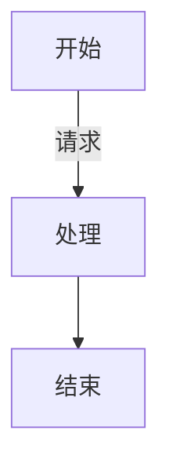
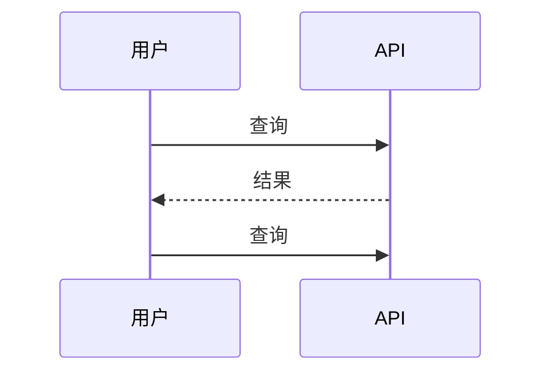

# Mermaid 可视化编辑 P0：固定版本原型验证

用途：记录内置 Mermaid 图形编辑的技术选型、可复现原型及尚未通过的门槛，供后续接入与验收参考。日期：2026-11-15。本记录只覆盖 P0，不能作为产品功能已交付的证明。

**结论：core + React Flow + Dagre 的基础组合有实测支持，Visimer DOM 单独不满足手动布局。完整 P0 门槛仍未通过，主要缺口是草稿的应用、取消与源码/布局整体撤销；本轮不进入生产 P1。**

## 已确认目标

flowchart 与 sequence 都支持修改已有图和从零创建，尽量通过添加元素、拖线与改文字完成。手动布局暂纳入保存，并提供“恢复默认排布”；具体保存方式仍可在用户验收时调整或移除。Mermaid 源码继续承载语义，不重写未编辑片段，不安全的语法保留原文并退回源码编辑。

## 技术方案与当前证据

A 使用 Visimer core + DOM，直接围绕 Mermaid 渲染图进行命中和源码操作。实测已有流程图标签、拖线，以及带别名和重复消息的时序图标签编辑可用；固定版本没有独立的实体显示坐标接口，不能满足保留手动布局。`seq.moveEvent` 修改源码中的事件顺序，不能用于假装保存显示位置；视口的缩放、平移同样不算实体布局。

B 使用 Visimer core 的语义图和文本补丁，投影到 React Flow 画布；Dagre 计算流程图默认位置。时序图采用有限的参与者/生命线/消息视图，参与者水平间距与消息语义顺序分离。React Flow 不自带 Mermaid parser，但本组合由 core 提供解析与操作，因此不能据此排除 B。下文列出 B 的实际证据与未覆盖边界；组合验证通过的部分不代表完整产品选型已通过。

在本轮核验范围内，尚未找到可以直接替代全部适配工作的成熟成品。本方案复用源码补丁、画布交互和默认布局三个已有能力，仍需承担实体映射、支持语法判定和布局保存的适配成本。复杂 sequence 片段不能为追求覆盖而扩展成完整自研引擎。

其他参考：[SeqDia](https://github.com/LegNeato/seqdia)提供时序数据模型与展示组件，但本轮未确认其具备 Mermaid 图形编辑和手动位置往返能力；[DrawCMS](https://github.com/drawcms/drawcms)是采用自身 `.drawcms` 文件的完整应用，接入形态与现有 Mermaid 源码编辑器不同。后者的 AGPL-3.0 需要在采用时评估，本需求没有“只能 MIT”的限制。本轮只实测 A 及一条组合 B，不将这些参考项目写成已验证的替代方案。

## 固定依赖

仅安装到 `scratch/mermaid-visual-editing-p0/dependencies`；未修改 workspace 生产依赖或锁文件。

| 包 | 实际版本 | 许可/来源 |
| --- | --- | --- |
| `@visimer/core` / `@visimer/dom` | 1.1.3 / 1.1.3 | MIT；源码锚点 `decb5ca0a1437d26d66004676952ab4d6d1a810d` |
| `@xyflow/react` | 12.12.1 | MIT；release commit `1bc405cd113618c17fd181b931a9fe573bec9fee` |
| `@dagrejs/dagre` | 3.1.3 | MIT；官方 `v3.1.3` tag |
| Mermaid | 11.17.2 | 复用当前仓库安装版本 |
| React / React DOM | 19.2.7 / 19.2.7 | B 复用应用实例，满足 React Flow 的 `>=17` peer 范围 |
| Vite / Playwright | 6.4.3 / 1.61.1 | 复用桌面应用开发依赖 |

随探针交付的 [dependency-lock.json](../../../scripts/mermaid-p0/dependency-lock.json) 固定隔离依赖闭包；其中四个直接依赖 SHA-512：

```text
@visimer/core  sha512-Kp0Wnb3Y7g/OpeIYEwH9Q01LPhFKDYJ3CSCpsK4XqofarVPakUaXEx55wCZ2QSC0CMxlgNlzPFdx2mByK/xvaA==
@visimer/dom   sha512-mcGw+BCGznqcgaP+BZMsSGI5LQu9bj34BPIhW8ljwtNkfuNZLqXaSXwly8og9ycMbGSln7hb+l7i8Wvx17lSpg==
@xyflow/react  sha512-g41OHmP+GL5wDBQKpgYt8AF6RlB4CrABtiStXhCMqdItK6gPdSpsuDk8V0YtdyvIvMPTjDJvkuLkz0JbSYu5Cw==
@dagrejs/dagre sha512-X4aUTwOReZvthaZWOVHqlJ52/ZdhZFEM4+Lh/uR4XooUSLE6p71bcy7MPGzYnNUcNh+nj+i/qJQpCMIdQnSmrg==
```

setup 从该 lock 生成隔离 manifest，复制为 scratch 下的 `package-lock.json`，再以 `npm ci` 重建；npm 校验包的完整性，不重新解析间接依赖。未执行生命周期安装脚本。Mermaid、React、Vite 与 Playwright 仍复用仓库现有安装，runner 核对其版本；Chromium 是运行前提，不包含在这份隔离 lock 内。

## 同一测试语料

两条路线均从以下原文及空白 `flowchart TD` / `sequenceDiagram` 开始：





参与者的 ID 是“客户端/服务端”，别名“用户/API”仅用于显示；消息引用 ID。完全重复的查询消息用于验证修改只命中目标。

## A：Visimer DOM 实测

真实 Chromium 手势探针记录 **8 PASS、1 UNSUPPORTED、5 NOT RUN**。测试脚本退出成功表示未出现已执行检查的 FAIL，不表示产品 P0 全部通过。

| 项目 | 结果 | 证据范围 |
| --- | --- | --- |
| 已有流程图实体映射 | PASS | 3 个节点、2 条边 |
| 已有时序图实体与别名映射 | PASS ×2 | 2 个参与者、3 条消息 |
| 修改流程图标签 | PASS | `开始 → 启动`，保留注释与 classDef |
| 实际拖线连接 | PASS | 从 A 拖到 C，新增连接 |
| 修改重复时序消息 | PASS | 第一条查询被修改，另一条查询及返回仍保留 |
| 空图源码操作 | PASS | 仅 core API 创建，不算图形创建通过 |
| 浏览器控制台 | PASS | 无 page/console error |
| 手动显示布局接口 | UNSUPPORTED | 实际 operation unions 无实体坐标；事件移动改变语义顺序 |
| 空图创建手势、时序消息创建手势 | NOT RUN ×2 | API 创建不能替代 UI 手势证据 |
| 流程图布局边同步、时序布局语义不变 | NOT RUN ×2 | 无独立布局接口可测 |
| 重渲染/主题/重开/重置/撤销 | NOT RUN | 本路线没有布局实现 |

结果文件为 `scratch/mermaid-visual-editing-p0/results/results.json`、`browser.png`、`layout-api-evidence.json`。后者保存安装包实际操作定义与事件移动实现片段，不凭入口文件关键词推断接口。

## B、布局保存及 P0 判定

真实 Chromium 探针最新记录 **28 PASS、2 NOT RUN、0 FAIL**。两条候选的 Node 浏览器回归合计 **2/2 通过**。B 的图元由 React Flow 呈现，源码仍由真实 Visimer core 操作；没有新建 Mermaid parser 或完整 sequence 引擎。

| 门槛 | 本轮证据 | 尚未证明的范围 |
| --- | --- | --- |
| G1 双图创建/编辑 | 流程图从零 3 节点、2 条实际拖线；时序图 2 参与者、请求及反向返回；标签可输入；生成源码通过 Mermaid 11.17.2 parse | 节点/参与者/关系删除未测 |
| G2 命中和手势 | 实际 Handle 拖线、输入框改标签、双击消息后输入文字；别名及完全重复查询消息准确对应 | 未测全部节点形状、事件类型 |
| G3 流程图显示布局 | 实际拖动、边路径变更、箭头存在，端点到精确 Handle 的距离小于 12 CSS px；默认排布实际移动节点 | 复杂样式/形状、字体测量及导出未测 |
| G4 时序显示布局 | 仅参与者水平位置；消息分行、方向和源码顺序不变；全部消息端点匹配生命线 Handle；真实重载后坐标及源码恢复 | 不支持任意消息 XY 拖动；复杂片段降级 |
| G5 布局保留 | 两类图标签/新增元素/主题重渲染/保存重载保留实际非默认位置；两类图重置后画布复位且当前源码不变 | 新参与者无别名时改 ID、多图和外部源码修改失配未测 |
| G6 草稿/历史 | 单次 core 添加可 undo，no-op 源码不变 | **完整草稿 apply/cancel、源码和布局一并撤销未实现/未测，不能通过** |
| G7 保真/降级 | 流程图、参与者别名、重复消息的目标文本替换外字节一致；loop、subgraph、无效源码保持原文并暂停画布；空源码重载不被示例替换 | 不代表全部 Mermaid 语法安全；支持矩阵仍需扩充 |

几何断言使用实际 core 实体和 Handle ID，通过 SVG 的点坐标 API 转换到屏幕坐标；不能只比较保存 JSON。早期约 259 px 的偏差来自探针把 DOM 顺序当成消息两端顺序，精确关联后全部已有消息端点通过，不能将该错误当作库的能力缺陷。位置保留检查也从“比较空对象”改为先拖出实际非默认位置。并发运行暴露的 Vite 优化缓存 504 已用独立缓存目录修复。

### 当前保存位置和方式

原型仅使用浏览器同一 origin 下的 localStorage：`mermaid-p0:flow`、`mermaid-p0:sequence` 各保存一张图；`mermaid-p0:type` 保存当前视图类型。“Save layout”显式保存源码和坐标快照，浏览器 `page.reload()` 后读取；不是文件系统保存或已选定的 Markdown 元数据格式。

本次实际保存的流程图快照如下，原始数据也在结果 JSON 的 `flowchart-save-reopen-source-layout.detail.savedPayload`：

```json
{
  "version": 1,
  "source": "flowchart TD\n  %% 保留注释\n  A[启动] -->|请求| B[处理]\n  B --> C[结束]\n  classDef custom fill:#eef,stroke:#334155",
  "layout": {
    "A": { "x": 24.169014084507054, "y": 9.295774647887328 },
    "B": { "x": 0, "y": 162 },
    "C": { "x": 0, "y": 324 }
  }
}
```

时序图的 Y 行按语义事件计算，保存的是参与者水平位置，拖动时参与者 Y 固定。损坏 JSON 会显示错误并保留原始缓存，已有真实重载检查；未知版本、安全上限和完整恢复流程未验证。

原型重置会移除该类型的缓存、重算当前画布位置；再次保存写入新快照。当前内存源码保持不变，但没有“取消重置后回滚缓存”的草稿边界。缓存还同时包含源码，不能把清除它直接当成生产“只清布局”操作。复制图块、同类型多图、重命名/移动文件、跨设备都没有由该实验格式解决。用户仍可在后续验收时调整或移除布局保存，无需把 localStorage 当作既定方案。

### 决定

保留 B 为基础技术候选；A 的 DOM 视图单独不满足手动布局。**完整 P0 产品可行性尚未通过，P1 停止。** 这是有界调研结论，不是“Mermaid 无法实现”，也不是要求减少图类型、创建场景或手动布局。

继续接入前至少补齐：一份完整草稿的应用/取消/源码与布局整体撤销证据，结构增删和无别名参与者身份变化，按文档/图块隔离的布局保存方案。随后再按 editor/SDK/provider 边界接入；不把当前原型的 localStorage 或状态接线复制进生产。

## 复现

在已有仓库依赖和 Playwright Chromium 的环境中，从仓库根目录运行：

```sh
node scripts/mermaid-p0/setup.mjs
node scripts/mermaid-p0/runner.mjs
node scripts/mermaid-p0-canvas/run.mjs
node --test scripts/mermaid-p0/*.test.mjs scripts/mermaid-p0-canvas/*.test.mjs
```

[A 探针说明](../../../scripts/mermaid-p0/README.md)、[B 探针说明](../../../scripts/mermaid-p0-canvas/README.md)说明安装位置与结果含义。首次下载包需要 npm 网络；探针使用本地 Vite 与浏览器，受限环境需允许回环监听和 Chromium 启动。失败应保留结果，不能通过跳过检查变成 PASS。

## 接入边界与未测项

P0 没有修改编辑器、SDK 或 Mermaid 生产接入。后续 editor 负责目标块身份、generation/revision、IME、stale、局部事务和主文档撤销；Mermaid 适配器负责语法能力、补丁和布局；应用负责 UI 组合。画布对象不能直接覆盖整篇 Markdown。

Chromium 原型不是 Tauri WebView、Web 应用、正文预览或 HTML 导出验证。文件系统保存、多图隔离、跨文档复制移动、外部源码变更、未知版本布局与安全上限、大图性能、生产体积及主文档历史均未在本记录中宣称通过。定向浏览器回归、Oxlint、Prettier 和结构检查通过（结构检查仅有 7 条已有体量警告）；JS 由 Node/Vite 加载检查。研究阶段仅运行定向检查，提交前的完整仓库 lint/test/typecheck 与远程 CI 结果记录在对应 PR 中；本次探针和文档未修改公开包，不需要 changeset。

## 上游参考

- [Visimer 固定源码](https://github.com/inkeep/visimer/tree/decb5ca0a1437d26d66004676952ab4d6d1a810d)：core 的图语义、补丁和 DOM 视图参考。
- [React Flow 自定义节点](https://reactflow.dev/learn/customization/custom-nodes)、[handles](https://reactflow.dev/learn/customization/handles)、[自定义边](https://reactflow.dev/learn/customization/custom-edges)、[保存恢复示例](https://reactflow.dev/examples/interaction/save-and-restore)：组合画布适配的公开接口。
- [React Flow 固定版本 manifest](https://github.com/xyflow/xyflow/blob/1bc405cd113618c17fd181b931a9fe573bec9fee/packages/react/package.json)：版本、MIT 与 peer 范围。
- [Dagre v3.1.3](https://github.com/dagrejs/dagre/releases/tag/v3.1.3)、[公开入口](https://github.com/dagrejs/dagre/blob/v3.1.3/index.ts)：默认有向图布局。
