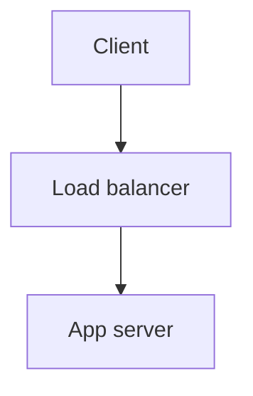

# @md-editor/syntax-plugins

The official Markdown syntax extensions for the CodeMirror 6 editor: highlight, math, Mermaid diagrams and container directives. Each one is a `MarkdownSyntaxPlugin` (the contract lives in `@md-editor/plugin-sdk/syntax`), so an editor only loads the ones you pass in.

Without a plugin the editor still shows plain CommonMark. A parse error or a library that has not loaded yet falls back to the source text and does not break the editor.

## Plugins

| Plugin | Id | Syntax | Notes |
| :--- | :--- | :--- | :--- |
| `highlightPlugin` | `markdown.highlight` | `==text==` | Shortcut `Mod-Shift-H`. |
| `mathPlugin` | `markdown.math` | `$E=mc^2$`, `$$ ... $$` | Rendered with KaTeX, which is loaded on first use. Moving the cursor into a formula shows its source. |
| `mermaidPlugin` | `markdown.mermaid` | ` ```mermaid ` code block | Rendered to SVG, which is loaded on first use. Follows the light and dark theme and supports click-to-zoom. |
| `containerDirectivePlugin` | `markdown.directive` | `:::info`, `:::tip`, `:::note`, `:::important`, `:::warning`, `:::danger`, `:::caution` | Rendered as a callout card with an icon. |

Mermaid example:

````markdown

````

## Usage

Pass the plugins you want to `CodeMirrorEditor` from `@md-editor/editor-ui`:

```tsx
import { CodeMirrorEditor } from "@md-editor/editor-ui";
import {
  containerDirectivePlugin,
  highlightPlugin,
  mathPlugin,
  mermaidPlugin,
} from "@md-editor/syntax-plugins";

const SYNTAX_PLUGINS = [highlightPlugin, containerDirectivePlugin, mathPlugin, mermaidPlugin];

<CodeMirrorEditor document={documentState} plugins={SYNTAX_PLUGINS} />;
```

Each plugin is also available from its own entry point: `@md-editor/syntax-plugins/math`, `/mermaid` and `/directive`. `OFFICIAL_SYNTAX_PLUGINS_METADATA` lists their names, descriptions and default state for the settings panel.

## Development

```bash
pnpm test
pnpm typecheck
```
